  

 

I build fintech software that is already running in production. My work is ASP.NET Core services, Vue 3 + Quasar frontends, and the gRPC plumbing that connects them to older microservices that can't be switched off. When I'm not shipping, I read code the way an attacker would.

 

<!--
  Live card: https://github-rpg-card.github-rpg-card.workers.dev/?username=eng-same&theme=dracula&reload=1236
  GitHub's image proxy times out on that URL, so .github/workflows/rpg-card.yml
  mirrors it into assets/rpg-card.svg daily. To link it live again, swap the src back.
-->

  

 

## Loadout

| Slot | Equipped |
| :--- | :--- |
| **Main hand** | `C#` &nbsp;`ASP.NET Core` &nbsp;`EF Core` &nbsp;`REST` &nbsp;`gRPC` |
| **Off hand** | `Vue 3` &nbsp;`Quasar` &nbsp;`Pinia` &nbsp;`TypeScript` &nbsp;`JavaScript` |
| **Pack** | `PostgreSQL` &nbsp;`RabbitMQ` &nbsp;`MassTransit` &nbsp;`Docker` &nbsp;`Linux` &nbsp;`Git` |
| **Lockpicks** | security testing &nbsp;·&nbsp; bug bounty &nbsp;·&nbsp; thinking like an attacker |

## Quest log

| Quest | Notes |
| :-- | :-- |
| **Fintech at Sarab** main quest · ongoing | Fintech systems in production. I build and maintain the ASP.NET backends, put Vue 3 + Quasar fronts on them, and make the legacy microservices more stable, one gRPC contract at a time. |
| [**FinWallet**](https://github.com/eng-same/FinWallet) side quest | A digital wallet simulation: a .NET modular monolith with DDD boundaries, a double-entry ledger, events over MassTransit + RabbitMQ, and a full audit trail. Starts with one `docker compose up`. |
| [**client‑website‑studio**](https://github.com/eng-same/client-website-studio) side quest | An Agent Skill kit that lets a marketing team ship bilingual Arabic/English company sites with an AI agent and publish them to the client's own Plesk or cPanel hosting, without touching code. |
| [**eng‑same.github.io**](https://eng-same.github.io) side quest | My portfolio. Vue 3, Vite and Quasar, built as one static page with dark mode. |

## House rules

1. **Legacy code isn't the enemy.** Leave it better than you found it, one commit at a time.
2. **The contract is the product.** A clear API outlives whatever is behind it.
3. **Write for the next person on a bad day.** Usually that's me, six months later.
4. **Ship it like someone will attack it.** Someone will.
5. **Play for position, not tricks.** That works on the chessboard and in a codebase.

## Party up

  
  
  
  

Found a bug in something I shipped? Tell me. Responsible disclosure is part of the paladin code.
